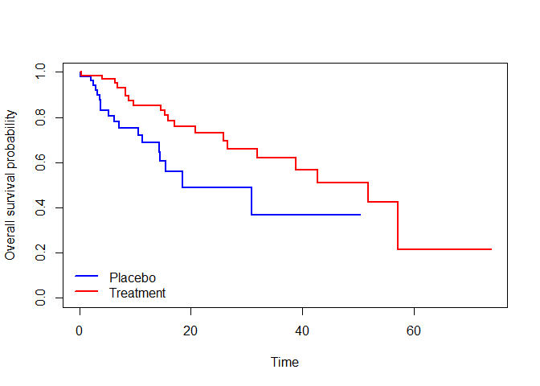
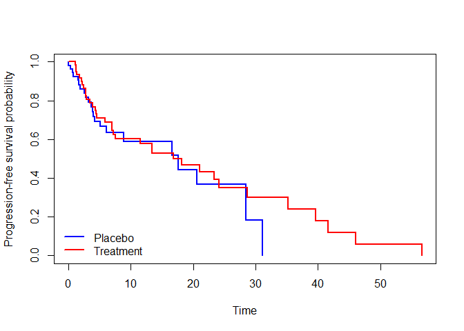

Oncology Clinical Trial Analysis (Simulated Data)
================
Najiya K

# Project overview

This project analyses a **simulated** two-arm oncology trial (Treatment
vs Placebo). The ADaM datasets (ADSL, ADTTE, ADAE) were created in SAS
and analysed in R. The data are simulated, so the aim is to show the
analysis workflow, not to make claims about a real treatment.

**Question.** Does the investigational treatment improve overall
survival (OS) and progression-free survival (PFS) compared with placebo,
and does it have a different adverse event (AE) profile? I used
simulated data so the whole workflow could be shown openly without any
patient data.

# Statistical Analysis Plan (summary)

| Item | Specification |
|----|----|
| Population | All randomised patients in ADSL (efficacy); patients with a treatment arm in ADSL (safety) |
| Efficacy endpoints | Overall survival (OS, `PARAMCD = "OS"`) and progression-free survival (PFS, `PARAMCD = "PF"`) |
| Event definition | Event when `CNSR == 0`; censored otherwise |
| Primary comparison | Treatment vs Placebo, Kaplan-Meier estimates and log-rank test |
| Effect estimate | Hazard ratio (HR) with 95% CI from a Cox proportional hazards model |
| Covariates | Primary models unadjusted for both OS and PFS; PFS additionally adjusted for age and sex as a sensitivity analysis |
| Assumption check | Proportional hazards assessed with `cox.zph` |
| Safety | Number and percentage of patients with at least one adverse event (AE), by maximum severity, and most common AE terms, using arm sizes from ADSL as denominators |

# Load packages and data

``` r
library(haven)
library(dplyr)
library(survival)

# Read the three SAS files (keep them in the same folder as this file)
adsl  <- read_sas("adsl.sas7bdat")
adtte <- read_sas("adtte.sas7bdat")
adae  <- read_sas("adae.sas7bdat")
```

## Analysis populations

``` r
# Patients per arm, and how many are in the ITT and safety populations
table(adsl$TRT01P, adsl$ITTFL)
```

    ##            
    ##              Y
    ##   Placebo   55
    ##   Treatment 65

``` r
table(adsl$TRT01P, adsl$SAFFL)
```

    ##            
    ##              Y
    ##   Placebo   55
    ##   Treatment 65

# Overall survival (OS)

``` r
# Keep the OS rows, add treatment, age and sex from ADSL, use the ITT population
adtte_os <- adtte %>%
  filter(PARAMCD == "OS") %>%
  left_join(adsl %>% select(USUBJID, TRT01P, AGE, SEX, ITTFL), by = "USUBJID") %>%
  filter(ITTFL == "Y")
```

## Kaplan-Meier curve

``` r
# CNSR == 0 means the event happened (the patient was not censored)
km_os <- survfit(Surv(AVAL, CNSR == 0) ~ TRT01P, data = adtte_os)

# Change "Time" to include your unit, for example "Time (months)"
plot(km_os, col = c("blue", "red"), lwd = 2,
     xlab = "Time", ylab = "Overall survival probability")
legend("bottomleft", legend = c("Placebo", "Treatment"),
       col = c("blue", "red"), lwd = 2, bty = "n")
```

<!-- -->

``` r
# Events and median survival (with 95% CI) for each arm
km_os
```

    ## Call: survfit(formula = Surv(AVAL, CNSR == 0) ~ TRT01P, data = adtte_os)
    ## 
    ##                   n events median 0.95LCL 0.95UCL
    ## TRT01P=Placebo   55     18   18.5    14.5      NA
    ## TRT01P=Treatment 65     21   51.7    31.9      NA

``` r
# Number at risk at chosen time points (change the times to suit your data)
summary(km_os, times = c(0, 15, 30, 45, 60, 75))
```

    ## Call: survfit(formula = Surv(AVAL, CNSR == 0) ~ TRT01P, data = adtte_os)
    ## 
    ##                 TRT01P=Placebo 
    ##  time n.risk n.event survival std.err lower 95% CI upper 95% CI
    ##     0     55       0    1.000  0.0000        1.000        1.000
    ##    15     15      15    0.606  0.0851        0.460        0.798
    ##    30      4       2    0.490  0.1026        0.325        0.738
    ##    45      1       1    0.367  0.1310        0.182        0.739
    ## 
    ##                 TRT01P=Treatment 
    ##  time n.risk n.event survival std.err lower 95% CI upper 95% CI
    ##     0     65       0    1.000  0.0000       1.0000        1.000
    ##    15     37       9    0.830  0.0522       0.7339        0.939
    ##    30     16       6    0.661  0.0754       0.5290        0.827
    ##    45      9       3    0.512  0.0969       0.3530        0.742
    ##    60      2       3    0.213  0.1204       0.0704        0.645

## Log-rank test

``` r
survdiff(Surv(AVAL, CNSR == 0) ~ TRT01P, data = adtte_os)
```

    ## Call:
    ## survdiff(formula = Surv(AVAL, CNSR == 0) ~ TRT01P, data = adtte_os)
    ## 
    ##                   N Observed Expected (O-E)^2/E (O-E)^2/V
    ## TRT01P=Placebo   55       18     11.3      3.92      5.98
    ## TRT01P=Treatment 65       21     27.7      1.61      5.98
    ## 
    ##  Chisq= 6  on 1 degrees of freedom, p= 0.01

## Cox model

``` r
cox_os <- coxph(Surv(AVAL, CNSR == 0) ~ TRT01P, data = adtte_os)
summary(cox_os)
```

    ## Call:
    ## coxph(formula = Surv(AVAL, CNSR == 0) ~ TRT01P, data = adtte_os)
    ## 
    ##   n= 120, number of events= 39 
    ## 
    ##                   coef exp(coef) se(coef)      z Pr(>|z|)  
    ## TRT01PTreatment -0.821     0.440    0.344 -2.386    0.017 *
    ## ---
    ## Signif. codes:  0 '***' 0.001 '**' 0.01 '*' 0.05 '.' 0.1 ' ' 1
    ## 
    ##                 exp(coef) exp(-coef) lower .95 upper .95
    ## TRT01PTreatment      0.44      2.273    0.2242    0.8636
    ## 
    ## Concordance= 0.62  (se = 0.042 )
    ## Likelihood ratio test= 5.59  on 1 df,   p=0.02
    ## Wald test            = 5.69  on 1 df,   p=0.02
    ## Score (logrank) test = 5.98  on 1 df,   p=0.01

``` r
# Check the proportional hazards assumption
cox.zph(cox_os)
```

    ##        chisq df    p
    ## TRT01P  1.32  1 0.25
    ## GLOBAL  1.32  1 0.25

**Interpretation.** In this simulated trial, the hazard of death was
lower on treatment than on placebo (HR 0.44, 95% CI 0.22 to 0.86; 39
deaths among 120 patients). The log-rank test agreed (p = 0.01). Median
OS was 18.5 on placebo and 51.7 on treatment, although some confidence
limits for the medians could not be estimated, so I read them with
caution. The proportional hazards check did not reject the assumption (p
= 0.25). The confidence interval is wide, so the data fit anything from
a modest to a large effect.

# Progression-free survival (PFS)

``` r
adtte_pfs <- adtte %>%
  filter(PARAMCD == "PF") %>%
  left_join(adsl %>% select(USUBJID, TRT01P, AGE, SEX, ITTFL), by = "USUBJID") %>%
  filter(ITTFL == "Y")
```

## Kaplan-Meier curve

``` r
km_pfs <- survfit(Surv(AVAL, CNSR == 0) ~ TRT01P, data = adtte_pfs)

plot(km_pfs, col = c("blue", "red"), lwd = 2,
     xlab = "Time", ylab = "Progression-free survival probability")
legend("bottomleft", legend = c("Placebo", "Treatment"),
       col = c("blue", "red"), lwd = 2, bty = "n")
```

<!-- -->

``` r
km_pfs
```

    ## Call: survfit(formula = Surv(AVAL, CNSR == 0) ~ TRT01P, data = adtte_pfs)
    ## 
    ##                   n events median 0.95LCL 0.95UCL
    ## TRT01P=Placebo   55     22   17.6    8.90      NA
    ## TRT01P=Treatment 65     35   18.1    7.58    35.2

## Log-rank test and Cox models

``` r
survdiff(Surv(AVAL, CNSR == 0) ~ TRT01P, data = adtte_pfs)
```

    ## Call:
    ## survdiff(formula = Surv(AVAL, CNSR == 0) ~ TRT01P, data = adtte_pfs)
    ## 
    ##                   N Observed Expected (O-E)^2/E (O-E)^2/V
    ## TRT01P=Placebo   55       22     19.6     0.295     0.487
    ## TRT01P=Treatment 65       35     37.4     0.154     0.487
    ## 
    ##  Chisq= 0.5  on 1 degrees of freedom, p= 0.5

``` r
# Main model, same as OS (no covariates)
cox_pfs <- coxph(Surv(AVAL, CNSR == 0) ~ TRT01P, data = adtte_pfs)
summary(cox_pfs)
```

    ## Call:
    ## coxph(formula = Surv(AVAL, CNSR == 0) ~ TRT01P, data = adtte_pfs)
    ## 
    ##   n= 120, number of events= 57 
    ## 
    ##                    coef exp(coef) se(coef)      z Pr(>|z|)
    ## TRT01PTreatment -0.1989    0.8196   0.2853 -0.697    0.486
    ## 
    ##                 exp(coef) exp(-coef) lower .95 upper .95
    ## TRT01PTreatment    0.8196       1.22    0.4685     1.434
    ## 
    ## Concordance= 0.522  (se = 0.039 )
    ## Likelihood ratio test= 0.48  on 1 df,   p=0.5
    ## Wald test            = 0.49  on 1 df,   p=0.5
    ## Score (logrank) test = 0.49  on 1 df,   p=0.5

``` r
# Extra check: adjusted for age and sex
cox_pfs_adj <- coxph(Surv(AVAL, CNSR == 0) ~ TRT01P + AGE + SEX, data = adtte_pfs)
summary(cox_pfs_adj)
```

    ## Call:
    ## coxph(formula = Surv(AVAL, CNSR == 0) ~ TRT01P + AGE + SEX, data = adtte_pfs)
    ## 
    ##   n= 120, number of events= 57 
    ## 
    ##                      coef exp(coef)  se(coef)      z Pr(>|z|)
    ## TRT01PTreatment -0.166350  0.846750  0.287227 -0.579    0.562
    ## AGE             -0.004326  0.995684  0.013799 -0.313    0.754
    ## SEXM             0.365247  1.440870  0.279779  1.305    0.192
    ## 
    ##                 exp(coef) exp(-coef) lower .95 upper .95
    ## TRT01PTreatment    0.8467      1.181    0.4822     1.487
    ## AGE                0.9957      1.004    0.9691     1.023
    ## SEXM               1.4409      0.694    0.8327     2.493
    ## 
    ## Concordance= 0.583  (se = 0.047 )
    ## Likelihood ratio test= 2.32  on 3 df,   p=0.5
    ## Wald test            = 2.28  on 3 df,   p=0.5
    ## Score (logrank) test = 2.3  on 3 df,   p=0.5

**Interpretation.** For PFS the unadjusted hazard ratio was 0.82 (95% CI
0.47 to 1.43), and adjusting for age and sex gave almost the same result
(HR 0.85, 95% CI 0.48 to 1.49). Both intervals include 1, so the
analysis does not show a PFS difference, but it is also too imprecise to
rule one out. In simulated data, an OS difference without a clear PFS
difference most likely reflects how the data were generated or chance,
so I do not read a biological mechanism into it.

# Safety analysis (adverse events)

``` r
# Safety population only
saf <- adsl %>% filter(SAFFL == "Y")

# Number of patients in each arm (used for the percentages below)
n_arm <- saf %>% count(TRT01A, name = "N")
n_arm
```

    ## # A tibble: 2 × 2
    ##   TRT01A        N
    ##   <chr>     <int>
    ## 1 Placebo      55
    ## 2 Treatment    65

``` r
# Treatment-emergent adverse events in the safety population
ae <- adae %>%
  filter(TRTEMFL == "Y") %>%
  inner_join(saf %>% select(USUBJID, TRT01A), by = "USUBJID")

# SAS cut "Neutropenia" to 8 characters, so I restore the full name here.
# Remove this line if the SAS data is regenerated with the full term.
ae <- ae %>% mutate(AEDECOD = recode(AEDECOD, "Neutrope" = "Neutropenia"))
```

## Patients with at least one adverse event

``` r
# Patients with at least one AE, as a percentage of each arm
ae %>%
  distinct(USUBJID, TRT01A) %>%
  count(TRT01A, name = "with_AE") %>%
  left_join(n_arm, by = "TRT01A") %>%
  mutate(pct = round(100 * with_AE / N, 1))
```

    ## # A tibble: 2 × 4
    ##   TRT01A    with_AE     N   pct
    ##   <chr>       <int> <int> <dbl>
    ## 1 Placebo        47    55  85.5
    ## 2 Treatment      47    65  72.3

``` r
# Total number of AE events per arm
ae %>% count(TRT01A, name = "events")
```

    ## # A tibble: 2 × 2
    ##   TRT01A    events
    ##   <chr>      <int>
    ## 1 Placebo      103
    ## 2 Treatment     97

## Maximum severity per patient

``` r
# Each patient is counted once, at their worst severity
ae %>%
  mutate(sev = factor(AESEV, levels = c("MILD", "MODERATE", "SEVERE"), ordered = TRUE)) %>%
  group_by(TRT01A, USUBJID) %>%
  summarise(max_sev = max(sev), .groups = "drop") %>%
  count(TRT01A, max_sev, name = "patients") %>%
  left_join(n_arm, by = "TRT01A") %>%
  mutate(pct = round(100 * patients / N, 1))
```

    ## # A tibble: 6 × 5
    ##   TRT01A    max_sev  patients     N   pct
    ##   <chr>     <ord>       <int> <int> <dbl>
    ## 1 Placebo   MILD            8    55  14.5
    ## 2 Placebo   MODERATE       12    55  21.8
    ## 3 Placebo   SEVERE         27    55  49.1
    ## 4 Treatment MILD            9    65  13.8
    ## 5 Treatment MODERATE       17    65  26.2
    ## 6 Treatment SEVERE         21    65  32.3

## Most common adverse events

``` r
# Top 5 AE terms per arm, counted by patients
ae %>%
  distinct(USUBJID, TRT01A, AEDECOD) %>%
  count(TRT01A, AEDECOD, name = "patients") %>%
  left_join(n_arm, by = "TRT01A") %>%
  mutate(pct = round(100 * patients / N, 1)) %>%
  group_by(TRT01A) %>%
  arrange(desc(patients), .by_group = TRUE) %>%
  slice_head(n = 5)
```

    ## # A tibble: 8 × 5
    ## # Groups:   TRT01A [2]
    ##   TRT01A    AEDECOD     patients     N   pct
    ##   <chr>     <chr>          <int> <int> <dbl>
    ## 1 Placebo   Headache          31    55  56.4
    ## 2 Placebo   Neutropenia       24    55  43.6
    ## 3 Placebo   Fatigue           17    55  30.9
    ## 4 Placebo   Nausea            13    55  23.6
    ## 5 Treatment Headache          25    65  38.5
    ## 6 Treatment Fatigue           22    65  33.8
    ## 7 Treatment Nausea            17    65  26.2
    ## 8 Treatment Neutropenia       16    65  24.6

**Interpretation.** I compared percentages of patients, not raw event
counts, because the arms are different sizes. 85.5% of placebo patients
and 72.3% of treatment patients had at least one AE, and 49.1% of
placebo patients and 32.3% of treatment patients had a severe AE as
their worst event. There is no sign of more toxicity on treatment in
these simulated data. These tables are descriptive only: I did no formal
testing and the sample is small.

# Conclusion

In this simulated trial, treatment was associated with a lower hazard of
death than placebo (HR 0.44, 95% CI 0.22 to 0.86), while PFS showed no
clear difference (HR 0.82, 95% CI 0.47 to 1.43). Both intervals are
wide. The AE summaries show no obvious safety signal on treatment, but
they are descriptive. Because all of the data are simulated, none of
this is evidence about a real treatment. The project shows how I would
carry out and report this type of analysis in R.

# Session information

``` r
sessionInfo()
```

    ## R version 4.3.1 (2023-06-16 ucrt)
    ## Platform: x86_64-w64-mingw32/x64 (64-bit)
    ## Running under: Windows 11 x64 (build 26300)
    ## 
    ## Matrix products: default
    ## 
    ## 
    ## locale:
    ## [1] LC_COLLATE=English_India.utf8  LC_CTYPE=English_India.utf8   
    ## [3] LC_MONETARY=English_India.utf8 LC_NUMERIC=C                  
    ## [5] LC_TIME=English_India.utf8    
    ## 
    ## time zone: Asia/Calcutta
    ## tzcode source: internal
    ## 
    ## attached base packages:
    ## [1] stats     graphics  grDevices utils     datasets  methods   base     
    ## 
    ## other attached packages:
    ## [1] survival_3.8-3 dplyr_1.1.4    haven_2.5.4   
    ## 
    ## loaded via a namespace (and not attached):
    ##  [1] vctrs_0.6.5       cli_3.6.4         knitr_1.45        rlang_1.1.5      
    ##  [5] xfun_0.52         highr_0.10        forcats_1.0.0     generics_0.1.3   
    ##  [9] glue_1.6.2        htmltools_0.5.8.1 hms_1.1.3         fansi_1.0.5      
    ## [13] rmarkdown_2.25    grid_4.3.1        evaluate_1.0.5    tibble_3.2.1     
    ## [17] tzdb_0.5.0        fastmap_1.2.0     yaml_2.3.7        lifecycle_1.0.5  
    ## [21] compiler_4.3.1    pkgconfig_2.0.3   rstudioapi_0.15.0 lattice_0.21-8   
    ## [25] digest_0.6.33     R6_2.6.1          readr_2.1.4       tidyselect_1.2.0 
    ## [29] utf8_1.2.3        splines_4.3.1     pillar_1.9.0      magrittr_2.0.3   
    ## [33] Matrix_1.5-4.1    withr_3.0.2       tools_4.3.1
